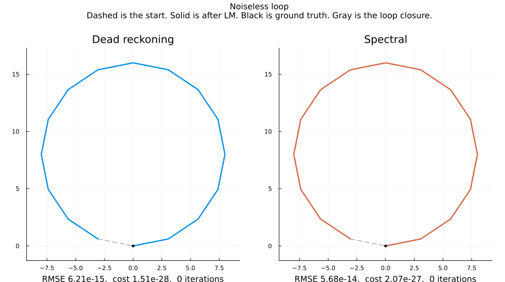
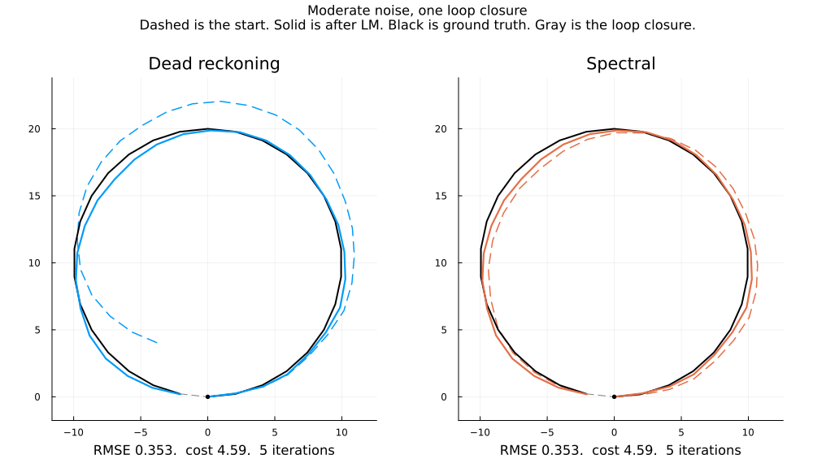
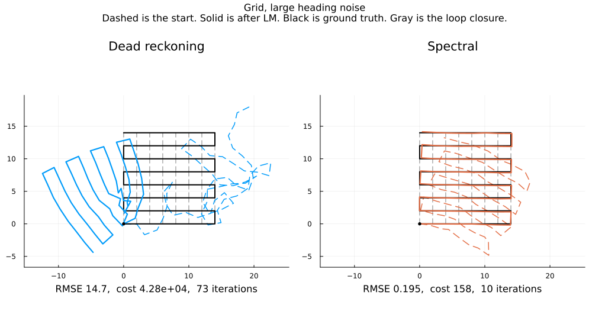
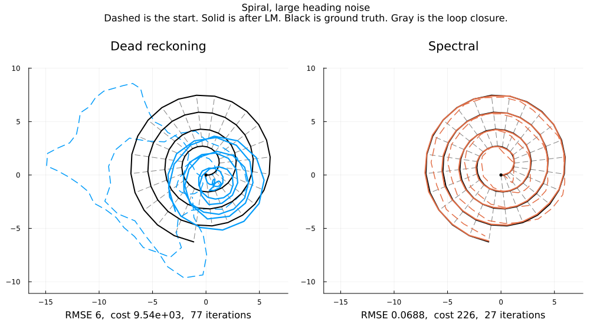

# 2D pose-graph SLAM

MATH 7207 mini-project. Maximum-likelihood estimation of SE(2) poses, refined by Levenberg–Marquardt from a dead-reckoning start and from a spectral start.

```
julia --project=. demo.jl
julia --project=. -e "using Pkg; Pkg.test()"
```

## Figures

`demo.jl` rewrites `figures/`. The copies below match `figures/results.txt`. In each path picture, dashed is the start, solid is after Levenberg–Marquardt, black is the truth, and gray is a loop closure. The left panel is dead reckoning. The right panel is the spectral start.

### Noiseless loop

Exact measurements. Both starts already sit on the truth, so the solver takes no steps. The three curves are stacked, and the gray chord is the one loop closure.



### One loop closure

Heading noise is small. Dead reckoning starts as the dashed arc outside the circle, about 9° off at the last stop. The spectral start is already close. Both finishes land on the same path: position error 0.35, cost 4.59, 5 iterations.



### Grid

Heading noise is large. Dead reckoning runs 73 iterations and stops on the skewed blue path: position error 14.7, cost about 4.3×10⁴. The loop closures were in that solve. The spectral start is already on the grid and finishes in 10 iterations, position error 0.19, cost 158.



### Spiral

Same split. Dead reckoning leaves the coil and stays there after 77 iterations: position error 6.0, cost 9542. The spectral start is already on the black spiral and finishes in 27 iterations, position error 0.07, cost 226.



## Sources

Levenberg and Marquardt: standard LM solver.
Grisetti, Kümmerle, Stachniss, and Burgard (2010): the dead-reckoning start.
Singer (2011) and Rosen, Carlone, Bandeira, and Leonard, SE-Sync (2019): the spectral start. This repository implements that start but doesn't run SE-Sync.
